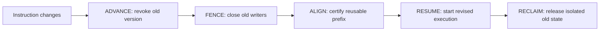

# RETIRE: Handling LLM Agent Interruptions with Safe KV Cache Reuse

[Paper](https://arxiv.org/abs/2610.01160) · [How it works](docs/agent-interruptions.md) · [vLLM integration](docs/vllm-integration.md) · [Citation](CITATION.cff)

RETIRE handles **mid-execution interruptions and task revisions in LLM agent
serving**. It prevents superseded executions from publishing stale output and
lets revised executions inherit certified, still-valid KV-cache prefixes.
Versioned execution coordinates cancellation, state handoff, and asynchronous
cleanup across the serving lifecycle.

This repository contains the reference runtime, a deterministic CPU demo,
protocol tests, and a research integration with vLLM.

**Paper:** [Serving a Revisable World: Versioned Execution for Interruptible
Agents](https://arxiv.org/abs/2610.01160)

Yanxin Zhang, Rahul Sharma, Nitin Vegesna, Zheyu Fu, Chang Liu, and
Trivikram Krishnamurthy.

## What happens when an agent's instructions change?

A coding agent is implementing a new API. While generation is running, the user
says: **“Keep the existing API; change only the implementation.”**

The agent runtime chooses a revised plan. The serving system must then:

- Stop delivering buffered output from the abandoned plan.
- Bound the obsolete work and isolate its remaining writes.
- Reuse the shared repository-context prefix when it is safe to do so.
- Start the revised execution while isolated old resources are reclaimed.

RETIRE represents that handoff with an execution version. Requests own
resources; the current version determines which outputs and state updates may
become visible.



## Try it locally

Requires Python 3.11 or newer. The demo uses scripted output and an in-memory
KV-block model; it needs no model download, GPU, or credentials.

```bash
git clone https://github.com/yanxinzhangcs/retire.git
cd retire
python3 -m venv .venv
source .venv/bin/activate
python -m pip install -e ".[dev]"
python -m retire_serving.demo
```

Expected output:

```text
old API-visible outputs: []
new API-visible outputs: ['revised plan output']
certified prefix tokens reused: 4
same prefix block inherited: True
old resources safely reclaimed: True
protocol: ADVANCE -> FENCE -> ALIGN -> RESUME -> RECLAIM
```

The demo checks these outcomes and fails if the handoff violates them. It
demonstrates protocol behavior, not model inference or a performance result.

Run the CPU tests with:

```bash
python -m pytest
```

Tests cover stale-output suppression, ownership generations, delayed writers,
tenant isolation, distributed participant receipts, and tiered state handling.
vLLM adapter tests use engine doubles; running them does not execute vLLM.

## What is included?

| Component | Purpose |
| --- | --- |
| [`src/retire_serving/`](src/retire_serving/) | Versioned runtime, output gates, KV ownership, and state certification |
| [`src/retire_serving/demo.py`](src/retire_serving/demo.py) | Runnable interruption and prefix-handoff example |
| [`src/retire_serving/backends/`](src/retire_serving/backends/) | vLLM adapters and explicit backend hooks |
| [`patches/`](patches/) | Research patches targeting vLLM 0.13.0 |
| [`examples/revise_vllm.py`](examples/revise_vllm.py) | Optional model-serving example with conservative cold fallback |
| [`tests/`](tests/) | Synthetic protocol and adapter tests |

The vLLM patches depend on specific internal APIs. Read the
[integration guide](docs/vllm-integration.md) before using them.

## Frequently asked questions

**Is this agent interruption recovery or pause/resume?**

RETIRE handles the serving-level handoff after an agent runtime replaces live
work. Pause/resume normally continues the same execution; a revision gives a
new execution authority and revokes the old one. RETIRE does not implement
workflow crash recovery, durable checkpoints, or rollback of tool side effects.

**Can a revised request reuse KV cache after cancellation?**

It can inherit a completed prefix when tokens, execution configuration,
numerical requirements, writer closure, and ownership evidence satisfy the
reuse contract. Missing evidence selects cold recomputation. A prefix match
alone is insufficient.

**How does this relate to LLM request preemption?**

Preemption temporarily removes work from a scheduler. Revision can invalidate
the work itself. RETIRE coordinates the authority change with output delivery
and state reuse. [Read the terminology and example](docs/agent-interruptions.md).

**Does the standard vLLM API provide certified KV inheritance?**

The API-only adapter gates output and uses a conservative cold path. Certified
physical KV inheritance needs the backend hooks and matching core integration.

## Cite the paper

```bibtex
@misc{zhang2026servingrevisableworld,
  title={Serving a Revisable World: Versioned Execution for Interruptible Agents},
  author={Yanxin Zhang and Rahul Sharma and Nitin Vegesna and Zheyu Fu and Chang Liu and Trivikram Krishnamurthy},
  year={2026},
  eprint={2610.01160},
  archivePrefix={arXiv},
  primaryClass={cs.DC},
  url={https://arxiv.org/abs/2610.01160}
}
```

Licensed under [Apache 2.0](LICENSE).
